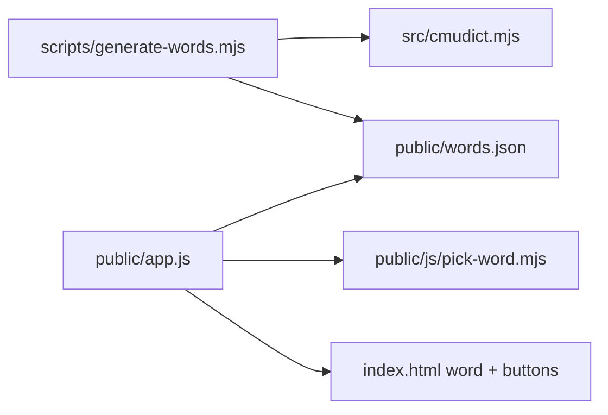

# Code map

Map of this project's codebase for the maintainer: which files do what, how data and control flow between them, where state lives. Prefer diagrams (mermaid or ASCII). Write in the first person (I, me, my).

## Layout

```
public/
  index.html           # PWA shell: word hitbox (random) + four buttons
  styles.css           # orange full-screen layout; white spaced buttons
  app.js               # loads words.json, pointerdown taps, registers SW
  js/pick-word.mjs     # pick next word (also used by tests)
  words.json           # syllable buckets from CMUdict
  sw.js                # offline cache
  manifest.webmanifest # installable app metadata
  icons/               # orange PWA icons
src/
  cmudict.mjs          # parse CMUdict / syllable count / bucket
scripts/
  generate-words.mjs   # download CMUdict → public/words.json
test/
  cmudict.test.mjs
  pick-word.test.mjs
wrangler.jsonc         # Cloudflare Pages output dir = public/
```

## Flow



## State

- Word lists: static `public/words.json` (bundled; no DB)
- Current on-screen word: in-memory in `public/app.js` only
- Offline assets: Cache Storage via `public/sw.js`
